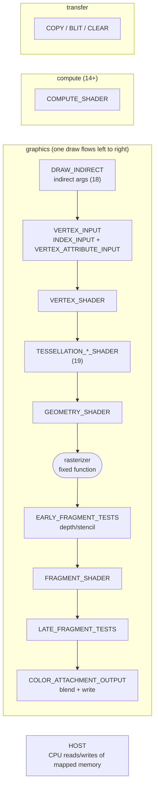
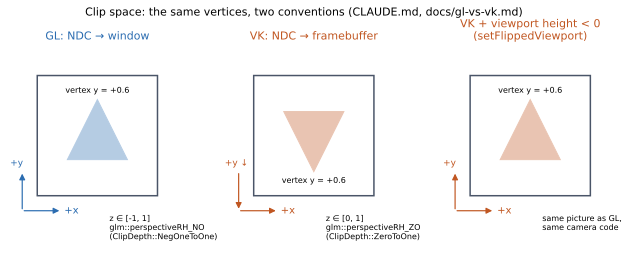
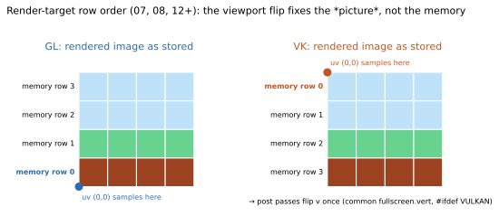

# OpenGL vs Vulkan — running cheat-sheet

Grown as techniques land. Each row should link to the technique where it first mattered.

## Pipeline stages — the names every VK barrier uses

A barrier says "after *these stages* did *these accesses*, before *those stages* do *those accesses*". The stages
(`VK_PIPELINE_STAGE_2_*`) are the boxes below. GL has the same hardware pipeline but never makes you name it.

`glMemoryBarrier(bit)` names only the *next use* (the destination); the source is always "earlier incoherent
writes" (shader storage/image writes, atomics). The VK equivalent of each bit's destination:

| `glMemoryBarrier` bit | VK dst stage | VK dst access | Seen in |
|---|---|---|---|
| `GL_VERTEX_ATTRIB_ARRAY_BARRIER_BIT` | `VERTEX_ATTRIBUTE_INPUT` | `VERTEX_ATTRIBUTE_READ` | 14 |
| `GL_ELEMENT_ARRAY_BARRIER_BIT` | `INDEX_INPUT` | `INDEX_READ` | |
| `GL_COMMAND_BARRIER_BIT` | `DRAW_INDIRECT` | `INDIRECT_COMMAND_READ` | (18) |
| `GL_UNIFORM_BARRIER_BIT` | the reading shader stage | `UNIFORM_READ` | |
| `GL_TEXTURE_FETCH_BARRIER_BIT` | the reading shader stage | `SHADER_SAMPLED_READ` (Glint uses `SHADER_READ`) | (16) |
| `GL_SHADER_IMAGE_ACCESS_BARRIER_BIT` | the accessing shader stage | `SHADER_STORAGE_READ \| WRITE` (image) | (16) |
| `GL_SHADER_STORAGE_BARRIER_BIT` | the accessing shader stage | `SHADER_STORAGE_READ \| WRITE` | 15 |
| `GL_BUFFER_UPDATE_BARRIER_BIT` | `COPY` | `TRANSFER_READ \| WRITE` | 15 |
| `GL_TEXTURE_UPDATE_BARRIER_BIT`, `GL_PIXEL_BUFFER_BARRIER_BIT` | `COPY` | `TRANSFER_READ \| WRITE` | |
| `GL_FRAMEBUFFER_BARRIER_BIT` | `COLOR_ATTACHMENT_OUTPUT`, fragment tests | attachment read/write | |

Everything *not* written through storage buffers/images (render targets, copies, uploads) GL synchronizes by
itself. VK doesn't distinguish: every hazard is yours, including write-after-read (14's cross-frame barrier).

## Conventions, in pictures

(Generated by `tools/diagrams.py`.)

## The table

| Topic | OpenGL 4.6 | Vulkan 1.3 | First seen |
|---|---|---|---|
| Window | `GLFW_CLIENT_API = GLFW_OPENGL_API` + version/profile hints; the window owns the context | `GLFW_CLIENT_API = GLFW_NO_API`; you create a `VkSurfaceKHR` for it | 01 |
| Context / device | Implicit, created with the window | Instance → physical device → logical device + queues, all explicit | 01 |
| Presentation | `glfwSwapBuffers` | Swapchain images, acquire/present, semaphores | 01 |
| Vsync | `glfwSwapInterval(1/0)` | Present mode FIFO / MAILBOX / IMMEDIATE, chosen at swapchain creation | 01 |
| Resize | Nothing to do (driver resizes the default framebuffer) | Recreate the swapchain (`OUT_OF_DATE` / `SUBOPTIMAL`), after the GPU is idle | 01 |
| CPU/GPU overlap | Driver buffers frames, `SwapBuffers` may block | Frames in flight: per-frame command buffer + fence, waited before reuse | 01 |
| Image layouts | Invisible | `UNDEFINED → COLOR_ATTACHMENT_OPTIMAL → PRESENT_SRC_KHR` via `vkCmdPipelineBarrier2` | 01 |
| Memory for a buffer | Driver's choice | `vkGetBufferMemoryRequirements` → pick a memory type by flags → `vkAllocateMemory` → bind | 01 |
| Destroying objects | Any time; freed once the GPU is done | Only when no queued work uses them (fence / `vkDeviceWaitIdle`) | 01 |
| Y axis | Framebuffer +Y up | +Y down; negative-height viewport restores GL's orientation | 01 |
| State | Global state machine: depth/cull/blend set before each draw, leaks unless reset | Immutable pipeline objects baked up front | 01 |
| Object editing | DSA (4.5): `glNamedBufferStorage(buf, …)`, `glVertexArrayAttribFormat(vao, …)`. Pre-DSA bind-to-edit: `glBindBuffer` + `glBufferData` | Every call names its object: `vkCmdBindVertexBuffers(cmd, …, &buf)` | 01 |
| Vertex layout | VAO: binding (buffer + stride) + attribute (location, format, offset); VAO also remembers the buffer | `VkVertexInputBindingDescription` + `VkVertexInputAttributeDescription` in the pipeline; buffer bound at record time | 01 |
| Per-draw constants | `layout(location = N) uniform` + `glProgramUniform*` | Push constants (`vkCmdPushConstants`), ≤ 128 bytes guaranteed | 01 |
| Index offset | `glDrawElements(…, (void*)byteOffset)` | `vkCmdDrawIndexed(…, firstIndex, …)` in indices | 01 |
| Shaders | GLSL text compiled by driver at runtime | SPIR-V compiled offline (`glslc`) | 01 |
| Clip-space depth | [-1, 1] → `ClipDepth::NegOneToOne` (`glm::perspectiveRH_NO`) | [0, 1] → `ClipDepth::ZeroToOne` (`glm::perspectiveRH_ZO`) | 02 |
| Clip-space Y | Up | Down → negative viewport height | 02 |
| Memory | Driver chooses (`glBufferStorage` flags are hints) | You pick memory type/heap, allocate, bind | 02 |
| Uniforms | `glUniform*` / UBO binding points | Descriptor sets + layouts, push constants | 02 |
| Synchronisation | Implicit (driver inserts hazards tracking) | Explicit barriers, fences, semaphores | 07 |
| Command submission | Immediate-looking calls | Record command buffers, submit to queue | 01 |
| Render targets | FBO object: `glNamedFramebufferTexture`, completeness check | No object: attachments listed in `VkRenderingInfo` per `vkCmdBeginRendering` | 07 |
| Pass-to-pass hazard | Implicit (driver orders write → sample) | Explicit image barrier + layout transition | 07 |
| Attribute-less draw | `gl_VertexID`, still needs an (empty) VAO bound | `gl_VertexIndex`, empty vertex input state | 07 |
| Stored depth | `d = z_ndc * 0.5 + 0.5` | `d = z_ndc` | 07 |
| Row order of render targets | Row 0 = bottom | Row 0 = top (even with the flipped viewport) → flip v when sampling a rendered image | 07 |
| "Now sample it" barrier | Implicit | `dstAccess = SHADER_READ` (sync validation flags `SHADER_SAMPLED_READ` alone) | 07 |
| Shadow compare | `GL_TEXTURE_COMPARE_MODE` on sampler/texture | `VkSamplerCreateInfo::compareEnable` | 08 |
| Shadow bias matrix | x, y, z: [-1,1] → [0,1] | x → [0,1], y → [1,0] (flipped rows), z unchanged | 08 |
| Showing a texture in ImGui | GL texture name as `ImTextureID` | `ImGui_ImplVulkan_AddTexture(view, layout)` → descriptor set | 08 |
| Depth-only pass | Vertex-only program, `glDrawBuffer(GL_NONE)` | Pipeline without fragment stage / color attachments | 08 |
| Channel swizzle | `GL_TEXTURE_SWIZZLE_RGBA` on the texture | `VkComponentMapping` on an image view | 08 |
| Debugging | `KHR_debug` callback (checks built into the driver, fairly shallow) | Validation layers + debug utils messenger (separate, thorough) | 01 |
| Object names | `glObjectLabel` | `vkSetDebugUtilsObjectNameEXT` | 01 |
| GPU timing | `GL_TIME_ELAPSED` query (ns), read when `GL_QUERY_RESULT_AVAILABLE` | Timestamp query pool, `vkCmdWriteTimestamp2` × 2, ticks × `timestampPeriod`; read after the frame's fence | 7 |
| Pipeline statistics | `GL_VERTICES_SUBMITTED`, `GL_*_SHADER_INVOCATIONS` queries (core 4.6; `glGenQueries` — Mesa rejects them in `glCreateQueries`) | `VK_QUERY_TYPE_PIPELINE_STATISTICS` pool, optional `pipelineStatisticsQuery` feature | 7 |
| Measuring CPU time | The driver blocks *inside* GL calls (e.g. waiting for a back buffer): with vsync on, "CPU" ≈ the vsync interval | Waits are explicit (`vkWaitForFences`, `vkAcquireNextImageKHR`): CPU time excludes them | 7 |
| RenderDoc hooking (Linux) | Symbol interposition: `librenderdoc.so` must be `LD_PRELOAD`ed | Implicit layer: manifest + `ENABLE_VULKAN_RENDERDOC_CAPTURE=1` before `vkCreateInstance` | 7 |
| Depth buffer | Comes with the default framebuffer | You create image + memory + view, transition it, attach it | 02 |
| Uploading static data | `glNamedBufferStorage(buf, size, data, 0)` | Staging buffer + `vkCmdCopyBuffer` + barrier (or direct write where a DEVICE_LOCAL+HOST_VISIBLE type exists, e.g. APUs) | 02 |
| Uniform binding | Uniform location / `glBindBufferBase` | Descriptor set layout + pool + set per frame slot, `vkCmdBindDescriptorSets` | 02 |
| Changing cull mode | `glEnable/glCullFace` any time | Pipeline state, or dynamic state `vkCmdSetCullMode` (core 1.3) | 02 |
| Texture upload | `glTextureStorage2D` + `glTextureSubImage2D` from a CPU pointer | Staging buffer + `vkCmdCopyBufferToImage` + layout transitions | 03 |
| Mipmaps | `glGenerateTextureMipmap` | Loop of `vkCmdBlitImage` + per-level barriers (check `SAMPLED_IMAGE_FILTER_LINEAR` first) | 03 |
| Changing a bound texture | `glBindTextureUnit` any time | `vkUpdateDescriptorSets` only on sets no pending work uses | 03 |
| Samplers | Sampler object (mutable) bound per unit, or params on the texture | `VkSampler` (immutable), in a descriptor | 03 |
| Texture binding | Global texture units (`glBindTextureUnit`) | Image view + sampler written into a descriptor set | 03 |
| Uniform blocks | `layout(std140, binding = N)` + `glBindBufferBase` | Same GLSL block as `set/binding`, via descriptor set | 04 |
| Updating in-use buffers | Allowed; driver copies/renames | Race: one buffer per frame in flight | 04 |
| Per-draw data | Update the UBO between draws | Dynamic UBO: one buffer, `UNIFORM_BUFFER_DYNAMIC`, per-draw offset aligned to `minUniformBufferOffsetAlignment` (or push constants) | 05 |
| Blending | `glEnable(GL_BLEND)` any time | Pipeline state → a second pipeline | 05 |
| Offset alignment for per-object UBO slices | `GL_UNIFORM_BUFFER_OFFSET_ALIGNMENT` (+ `glBindBufferRange`) | `minUniformBufferOffsetAlignment` (+ dynamic offsets) — 4 on this AMD, 256 on NVIDIA | 09 |
| Shader variants | `#define`s injected into GLSL, recompile per variant | Specialization constants (`constant_id`) on one SPIR-V, per pipeline | 10 |
| Binding by update frequency | UBO binding point / texture units / loose uniforms — no grouping | Set 0 per frame, set 1 per material, push constants per draw | 11 |
| `discard` | Just works | SPIR-V `OpDemoteToHelperInvocation` → enable `shaderDemoteToHelperInvocation` (1.3 feature) | 11 |
| One shader source | Text + `#include` resolved by the app; no `VULKAN` macro | glslc (`-I`, predefines `VULKAN`); `#ifdef VULKAN` for per-API syntax | 12 |
| sRGB textures | `GL_SRGB8_ALPHA8`: hardware decodes on sample | `VK_FORMAT_R8G8B8A8_SRGB` (same) | 12 |
| sRGB output | `glEnable(GL_FRAMEBUFFER_SRGB)` on an sRGB-capable framebuffer | `_SRGB` swapchain format (or a mutable-format view) | 12 |
| Float render target | `GL_RGBA16F` texture in an FBO | `R16G16B16A16_SFLOAT` image as attachment, barrier, then sampled | 12 |
| Push constants | None — emulate with a small UBO rewritten per draw | `vkCmdPushConstants`, ≥128 bytes | 12 |
| Rendering into one mip level | `glTextureView` of that level (or `glNamedFramebufferTexture(..., level)`) | `VkImageView` with `baseMipLevel = i, levelCount = 1` | 13 |
| Mip levels in different states | Nothing to track | Per-level layouts: barriers with a `subresourceRange` for the level being written/read | 13 |
| Keeping attachment contents | Default: contents stay until `glClear` | Say so per pass: `loadOp = LOAD` (vs `CLEAR` / `DONT_CARE`) | 13 |
| Updating a texture in use | `glTextureSubImage2D`; the driver protects in-flight frames | Staging per frame slot + `vkCmdCopyBufferToImage` + barriers inside the frame | 13 |
| Format capabilities | Fixed required-renderable list (`R11F_G11F_B10F` is in it) | Query `vkGetPhysicalDeviceFormatProperties` (attachment, blend, linear filter) | 13 |
| Compute pipeline | Program with one `GL_COMPUTE_SHADER` stage | `vkCreateComputePipelines`: one stage + layout; own bind point; dispatch outside rendering | 14 |
| Storage buffers | `glBindBufferBase(GL_SHADER_STORAGE_BUFFER, n)`; any buffer, any role | `STORAGE_BUFFER` descriptor; `usage` must list every role (storage, vertex, ...) | 14 |
| Compute → draw hazard | `glMemoryBarrier(bit for the *next use*)`, e.g. `GL_VERTEX_ATTRIB_ARRAY_BARRIER_BIT` | Buffer barrier `COMPUTE_SHADER/STORAGE_WRITE → VERTEX_ATTRIBUTE_INPUT/ATTRIBUTE_READ`, plus the cross-frame WAR one | 14 |
| Point size | `gl_PointSize` only with `GL_PROGRAM_POINT_SIZE`, else `glPointSize` | `gl_PointSize` must be written; > 1 needs `largePoints` | 14 |
| Primitive type | Argument of each draw call | Pipeline state (`topology`) | 14 |
| Subgroup operations | Extension `GL_KHR_shader_subgroup`; size/stages/features via `glGetIntegerv` | Core 1.1; `VkPhysicalDeviceSubgroupProperties` (size, stages, operations); same GLSL | 15 |
| Compute → compute | `glMemoryBarrier(GL_SHADER_STORAGE_BARRIER_BIT)` | `VkMemoryBarrier2` (global) or buffer barrier, `COMPUTE/STORAGE_WRITE → COMPUTE/STORAGE_READ\|WRITE` | 15 |
| Timing GPU work | `glQueryCounter(GL_TIMESTAMP)`, poll `GL_QUERY_RESULT_AVAILABLE` | Timestamp query pool: reset in the command buffer, `vkCmdWriteTimestamp2`, read after the fence; × `timestampPeriod` | 15 |
| Reading results back | `glCopyNamedBufferSubData` → `MAP_READ \| CLIENT_STORAGE` buffer → map (direct reads make NVIDIA migrate the buffer) | `vkCmdCopyBuffer` → `HOST_VISIBLE \| HOST_CACHED` buffer, `COPY → HOST` barrier, fence, read mapping | 15 |
| Same descriptors, two pipeline kinds | Bindings are global | Bind the set at the compute *and* the graphics bind point | 15 |
| Multiple viewports | `glViewport` between draws | `vkCmdSetViewport` + `vkCmdSetScissor` (dynamic state) between draws | 10 |
