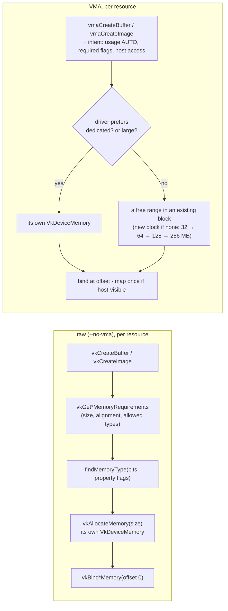
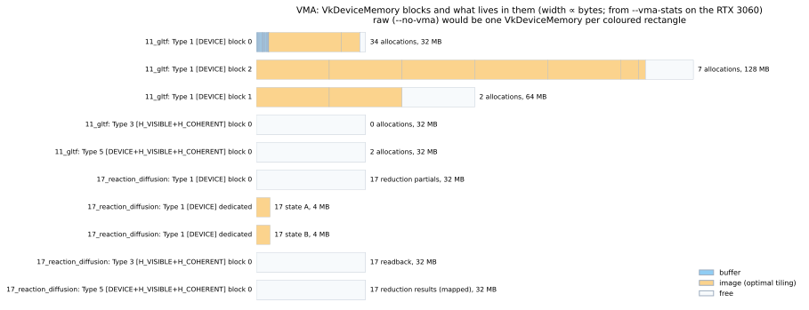

# VMA — what the Vulkan Memory Allocator decides for us

Introduced on 2026-10-27, after techniques 01–17 had allocated every buffer and image raw. It's the open Stage 9
item from `docs/PLAN.md`.

## What changed
- `vk::Buffer` and `vk::Image` (`src/vk/buffer.cpp`, `src/vk/image.cpp`) allocate through VMA by default. Their
  interfaces didn't change, so no technique code changed.
- **`--no-vma`** brings back the raw path: one `vkAllocateMemory` per buffer or image, exactly as 01/02 write it.
  Both paths are kept on purpose, to compare.
- Every technique switch logs a `memory` line next to its `summary` line:
  `VMA: 45 allocations in 5 VkDeviceMemory blocks, 186.9 MB used of 288.0 MB allocated`, or
  `raw: 45 allocations = 45 VkDeviceMemory objects, 186.9 MB`.
- **`--vma-stats FILE`** writes VMA's JSON (every block, every sub-allocation with offset, size, type and name).
  `tools/diagrams.py` draws it (figure below).
- **`tools/parity.py --vk-args=--no-vma`** runs the parity check on the raw path.
- These stay raw **on purpose**, because the raw code is the lesson:
  - 01 and 02's buffers and depth image;
  - 16's 3D image;
  - the app's screenshot readback buffer.

  None of them is counted in the memory line.

## Raw vs VMA, step by step

How Glint's existing `VkMemoryPropertyFlags` are translated (`buffer.cpp`):

| Asked for | VMA create info | What happened on the RTX 3060 |
|---|---|---|
| `DEVICE_LOCAL` (vertex/index/storage buffers) | `usage = AUTO`, `requiredFlags = DEVICE_LOCAL` | shared device-local blocks |
| `HOST_VISIBLE \| HOST_COHERENT` (per-frame UBOs, staging) | + `HOST_ACCESS_SEQUENTIAL_WRITE`, `MAPPED` | **memory type 5: DEVICE_LOCAL + HOST_VISIBLE**: video memory the CPU writes directly (the "BAR" window), picked by VMA on its own |
| `... \| HOST_CACHED` (15's readback) | + `HOST_ACCESS_RANDOM`, `MAPPED` | a host-cached system-memory type: fast CPU reads |
| images | `usage = AUTO_PREFER_DEVICE` | in blocks, or **dedicated** when the driver prefers it (17's storage + attachment images) |

## What it decided — measured (RTX 3060, VK, Debug, all 17 techniques)

| Technique | Raw: `VkDeviceMemory` objects | VMA: allocations / blocks | Used / allocated (VMA) |
|---|---|---|---|
| 03_textured_cube | 9 | 9 / 3 | 4.2 / 96 MB |
| 11_gltf | 45 | 45 / 5 | 187 / 288 MB |
| 13_bloom | 18 | 18 / 4 | 7.2 / 100 MB |
| 14_compute_particles | 2 | 2 / 2 | 35.9 / 35.9 MB |
| 17_reaction_diffusion | 5 | 5 / 5 (2 dedicated) | 8 / 104 MB |

- **Sub-allocation**: 11's 34 vertex and index buffers share one 32 MB block. The raw path makes 34
  `VkDeviceMemory` objects for them. Drivers cap the number of allocations (`maxMemoryAllocationCount`, 4096 on
  many drivers; NVIDIA reports 2³²−1), and each allocation is a kernel call.
- **Block growth**: blocks start at 1/8 of the preferred size (256 MB on this heap) and double: 32 → 64 → 128 MB.
  The 22 MB FlightHelmet textures fill the larger ones.
- **The footprint is bigger, not smaller, at this scale**: one block per memory type used, so 03 reserves
  96 MB for 4 MB of resources. VMA also **keeps one empty block** per type after staging buffers are freed (11's
  type 3 block: 0 allocations, 32 MB), so the next upload doesn't allocate again. This trades memory for fewer
  allocations; with real scene sizes the blocks fill up.
- **Large resources stand alone**: 14's 32 MB particle buffer is too big to share a block usefully. 17's
  simulation images get **dedicated** allocations because the driver asks for them
  (`VkMemoryDedicatedRequirements`, core 1.1). Dedicated memory can be faster for render targets and storage
  images (compression, placement).
- **Memory type choice**: VMA put the per-frame uniform buffers in the device-local + host-visible type, where
  the raw `findMemoryType` takes the first type with the requested flags. GPU reads come from video memory and
  CPU writes go over PCIe write-combining.
- **Correctness and speed**: parity is identical with and without VMA (17/17, same PSNR) and validation is
  clean on both paths. 11_gltf frame times don't change measurably (CPU ~2 ms, GPU 0.07 ms either way). At 45
  allocations the gain is in structure, not speed.
- **A free leak check**: `vmaDestroyAllocator` asserts if any allocation is still alive at shutdown.

## GL comparison
GL has no counterpart to any of this. `glNamedBufferStorage(size, data, flags)` with `GL_MAP_*` /
`GL_DYNAMIC_STORAGE_BIT` / `GL_CLIENT_STORAGE_BIT` is a *hint*, and the driver decides the memory type, packs
small buffers together and may migrate them later. 15's readback showed NVIDIA moving SSBOs to system memory
after one `glGetNamedBufferSubData`. In VK, the application, or VMA on its behalf, makes those decisions once,
and they stay put.

## Reading
- VMA documentation: [Choosing memory type](https://gpuopen-librariesandsdks.github.io/VulkanMemoryAllocator/html/choosing_memory_type.html),
  [Recommended usage patterns](https://gpuopen-librariesandsdks.github.io/VulkanMemoryAllocator/html/usage_patterns.html)
  (the GPU-only / staging / readback / "advanced data uploading" via BAR cases above).
- Vulkan spec: `vkAllocateMemory` (allocation limits), `VkMemoryDedicatedRequirements`, `bufferImageGranularity`.

(Figure generated by `tools/diagrams.py vma_blocks` from `docs/data/vma_*.json`. Regenerate the dumps with
`glint_vk <technique> --vma-stats docs/data/vma_<technique>.json`.)
