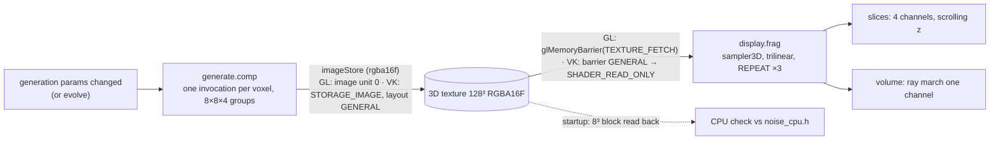
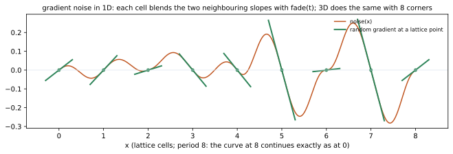
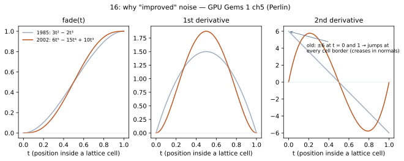
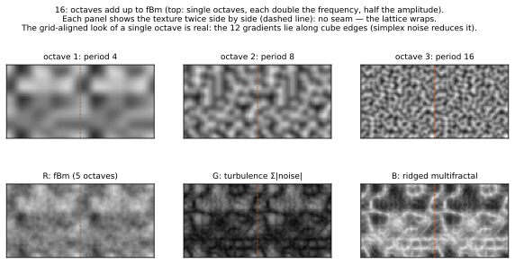

# 16_noise

## What it shows
A compute shader **writes a 3D texture**, 128³ RGBA16F by default (64³ / 256³ selectable), with one procedural
noise per channel. Each tiles seamlessly with the texture:

| Channel | Noise | From |
|---|---|---|
| R | fBm of improved Perlin noise | GG2 ch26 `inoise.fxh` `fBm` |
| G | turbulence (Σ\|noise\|) | `turbulence` |
| B | ridged multifractal | `ridgedmf` (Musgrave) |
| A | Worley F1, inverted | Worley 1996 |

A full-screen pass then samples the texture in one of two modes:
- **slices**: all four channels as z-slices that scroll through the volume, each repeated 2×2 to show the
  tiling;
- **volume**: one channel ray-marched in a cube, with emission-absorption and one light tap.

The texture is regenerated only when a generation parameter changes, or every frame with **evolve** (a moving
domain offset). At startup both apps read an 8³ block back and compare all four channels with a **C++ reference
implementation** (`noise_cpu.h`), and log the result.

## Read
- [GG1 ch5 Implementing Improved Perlin Noise](https://developer.nvidia.com/gpugems/gpugems/part-i-natural-effects/chapter-5-implementing-improved-perlin-noise)
  — Perlin himself on the two fixes over 1985 noise:
  - the 6t⁵−15t⁴+10t³ fade, continuous in its 2nd derivative (figure below);
  - the 12 cube-edge gradients instead of random ones.

  Local CD: — (online only)
- [GG2 ch26 Implementing Improved Perlin Noise](https://developer.nvidia.com/gpugems/gpugems2/part-iii-high-quality-rendering/chapter-26-implementing-improved-perlin-noise)
  — the GPU implementation and the fractal sums, written for pixel shaders: the permutation and gradients live in
  textures, the only lookup tables shaders had in 2005.
  - Local CD: `GPU-Gems-2-CD-Content/High-Quality_Rendering/Ch_26_Implementing_Improved_Perlin_Noise/inoise.fxh`.
  - Glint's permutation table (`shaders/permutation.inc`) and gradient table are copied from that file.
- Steven Worley, *A Cellular Texture Basis Function* (SIGGRAPH 1996): F1 = distance to the nearest feature point.

## Diagrams

How gradient noise is built, and why the "improved" fade matters (`tools/diagrams.py`, using the same permutation
file as the shaders):

Figures are generated by `tools/diagrams.py` (regenerate after changing the technique).

## One noise source, three languages
- `shaders/permutation.inc` holds Perlin's 256 numbers and is `#include`d by **GLSL** (`noise.glsl`, inside an
  `int[256](...)` initializer), by **C++** (`noise_cpu.h`, inside a `constexpr int[256]`) and by **Python**
  (`tools/diagrams.py` reads the file).
- `noise_cpu.h` mirrors `noise.glsl` line for line. The startup check catches any drift between them. That
  includes GLSL's undefined `%` on negative ints, which is why `wrap()` shifts the value positive first.
- Tiling: the lattice coordinates wrap with `period` (base octave = 4 cells across the texture). Each octave
  doubles both the frequency and the period, so every octave and the sum tile. Worley wraps its cells the same
  way.

## GL path
- **Texture**: `glCreateTextures(GL_TEXTURE_3D)` + `glTextureStorage3D(1 level, GL_RGBA16F, n, n, n)`. Image
  binding needs immutable storage.
- **Write**: `glBindImageTexture(0, tex, 0, layered = GL_TRUE, 0, GL_WRITE_ONLY, GL_RGBA16F)`.
  - **Image units** are their own binding points, separate from texture units: image unit 0 and texture unit 0
    are different slots.
  - `layered = GL_TRUE` binds the whole 3D texture; `GL_FALSE` + `layer` would bind one 2D slice.
  - The format must match the shader's `rgba16f` qualifier.
- **Barrier**: `glMemoryBarrier(GL_TEXTURE_FETCH_BARRIER_BIT | GL_TEXTURE_UPDATE_BARRIER_BIT)`. The next uses are
  sampling and `glGetTextureSubImage` (the CPU check); imageStore writes are incoherent, like SSBO writes.
- **Read**: an ordinary `sampler3D` on texture unit 0, with a sampler object that repeats on S, T **and R**.
  `gl::Sampler` didn't set `GL_TEXTURE_WRAP_R` until now (fixed in `src/gl/texture.cpp`). A clamping sampler
  would have clamped two axes of a 3D texture and repeated the third.
- **CPU check**: `glGetTextureSubImage` of the 8³ block, with the driver converting half to float.

## VK path
- **The 3D image, raw** (`vk::Image` is 2D-only):
  - `imageType = VK_IMAGE_TYPE_3D` with `extent.depth = n` and `arrayLayers = 1`;
  - usage `STORAGE | SAMPLED | TRANSFER_SRC`, declared up front;
  - a `VK_IMAGE_VIEW_TYPE_3D` view.
- **Format check**: `STORAGE_IMAGE` + `SAMPLED_IMAGE_FILTER_LINEAR` for `R16G16B16A16_SFLOAT`. RGBA16F storage
  is mandatory in the spec, but e.g. R16F storage needs `shaderStorageImageExtendedFormats`.
- **Two descriptors for one image**:
  - a `STORAGE_IMAGE` for compute, written raw (no sampler, `imageLayout = GENERAL`);
  - a `COMBINED_IMAGE_SAMPLER` for display (`SHADER_READ_ONLY_OPTIMAL`).
- **Layouts**: storage access requires `GENERAL`. Each regeneration:
  - `UNDEFINED → GENERAL`: contents discarded, ordered after earlier sampling and copies;
  - then the dispatch;
  - then `GENERAL → SHADER_READ_ONLY`: compute storage write → fragment read.
  - Frames that don't regenerate record no barriers at all. Sampling in `GENERAL` would be legal too;
    `READ_ONLY` is the layout drivers may optimize for.
- **CPU check**: barrier → `TRANSFER_SRC`, `vkCmdCopyImageToBuffer` of the block (raw halfs), barrier back,
  `COPY → HOST`. The next frame does `vkDeviceWaitIdle` and converts the halfs with `glm::unpackHalf1x16`.

## Differences that matter
- **Storage images**: GL binds a texture *level* to an image unit with an access mode and a format. VK writes a
  `STORAGE_IMAGE` descriptor and requires the `GENERAL` layout while the shader accesses it. The GLSL
  (`IMAGE(0, 0, rgba16f) writeonly image3D`, `imageStore`) is the same.
- **3D textures**: one enum in GL (`GL_TEXTURE_3D` + `glTextureStorage3D`). In VK it's the image type, a real
  `depth`, and a 3D view type.
- **Declaring roles**: in GL the same texture is an image or a sampled texture depending on what you bind it to.
  In VK every role is a usage bit at creation.

## Gotchas hit
- **`GL_TEXTURE_WRAP_R`** was never set by `gl::Sampler` (latent since 03; harmless until a 3D texture). VK's
  `createSampler` always set `addressModeW`.
- **Negative `%` in GLSL is undefined.** Worley's neighbour cells reach -1, so `wrap()` adds `1024 * period`
  first, identically in C++.
- **Regenerating is expensive** (RTX 3060, 1280×720, Debug, frame GPU time):

  | Texture | Static | Evolve, GL | Evolve, VK |
  |---|---|---|---|
  | 128³ | ~0.04–0.2 ms | 7.1 ms | 5.8 ms |
  | 256³ | — | 42 ms | 55 ms |

  That's 2M voxels × 15 Perlin evaluations + 27 Worley cells each, so a static texture is the right default.
- **Table vs hash**: GG2 ch26 put the permutation in a texture because 2005 shaders had no arrays. Glint uses a
  `const int[256]`. Replacing it with an arithmetic hash didn't give a clear win on the RTX (GL 9.6 ms, VK
  4.9 ms vs 7.1 / 5.8), so the table isn't the bottleneck here. The arithmetic (15 noise evaluations of 8
  corners each) is.

## Numbers
- LOC: gl.cpp 127, vk.cpp 267.
- **Parity:** ∞ dB (pixel-identical) in slices mode; volume mode 75–76 dB.
- **CPU check:** max error 0.00049 in both APIs, which is half a half-float step at values near 1.
- **Validation:** clean in both APIs.
