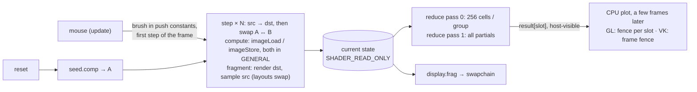
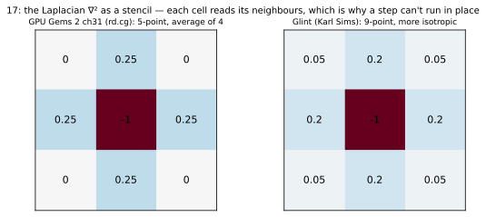
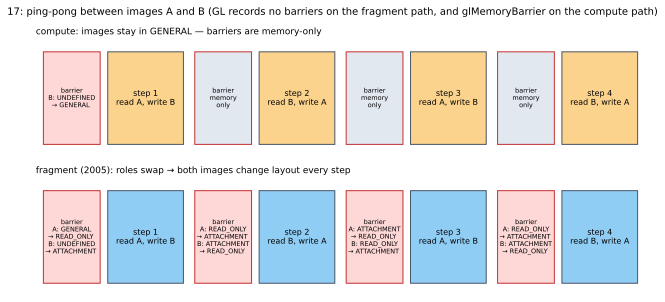
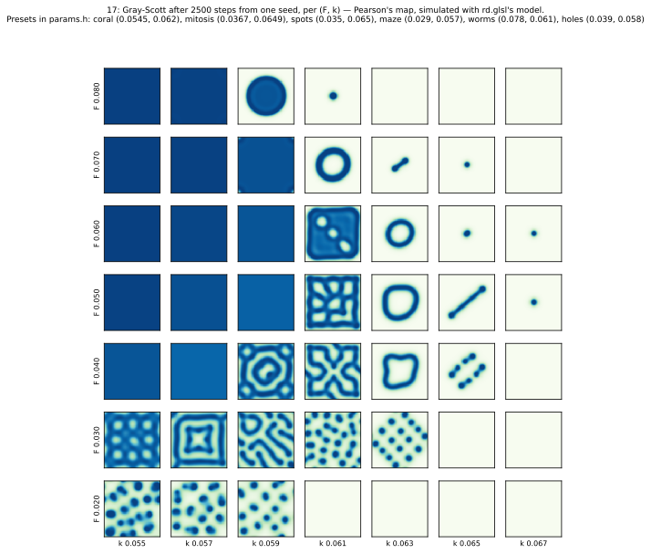

# 17_reaction_diffusion

## What it shows
**Gray-Scott reaction-diffusion**, GPU Gems 2 ch31's own worked example, on a wrapping grid (256² / 512² /
1024²). It runs N steps per frame and you can **paint** chemical v in with the left mouse. Six presets from
Pearson's (F, k) map are included (coral, mitosis, spots, maze, worms, holes), plus F/k sliders.

There are two ways to run a step, behind a UI toggle, with the same math (`shaders/rd.glsl`):
- **compute**: `imageLoad` the source image, `imageStore` the destination;
- **fragment** (the 2005 GPGPU way, as in ch31): render a full-screen triangle *into* the destination while
  sampling the source. ch31's vocabulary: stream = texture, kernel = fragment program, feedback =
  render-to-texture.

Every frame a two-pass **reduction** sums v over the grid. The total comes back to the CPU **without stalling**
and is plotted in the UI. At startup both paths are checked against a C++ reference (`rd_cpu.h`), and the result
is logged.

This technique was added after 16, when we noticed 15 had used ch31 only as background reading and skipped the
chapter's actual example.

## Read
- [GG2 ch31 Mapping Computational Concepts to GPUs](https://developer.nvidia.com/gpugems/gpugems2/part-iv-general-purpose-computation-gpus-primer/chapter-31-mapping-computational)
  — §31.3 CPU–GPU analogies (streams, kernels, feedback, gather vs scatter), §31.5 "A Simple Example": Gray-Scott.
  - Local CD: `GPU-Gems-2-CD-Content/General-Purpose_Computation_on_GPUs_A_Primer/Ch_31_Mapping_Computational_Concepts_to_GPUs/DEMOS/OpenGL/src/`
    — `gpgpu_reactiondiffusion/rd.cg` (the kernel, 5-point Laplacian), `gpgpu_reactiondiffusion.cpp` (ping-pong
    with pbuffers), `gpgpu_reductions/` (log₂ n render passes per reduction).
- Karl Sims, [Reaction-Diffusion Tutorial](https://www.karlsims.com/rd.html): the 9-point stencil, Du = 1,
  Dv = 0.5 and the presets used here. John Pearson, *Complex Patterns in a Simple System* (Science, 1993): the
  (F, k) map.

## Diagrams

The Laplacian is a stencil over the neighbours, which is why a step can't run in place:

What each path records for four steps, replayed from `vk.cpp`'s layout tracker:

Pearson's map, simulated with the same model (a small numpy port in `tools/diagrams.py`):

Figures are generated by `tools/diagrams.py` (regenerate after changing the technique).

## GL path
- **Two `GL_RGBA32F` textures** (A, B), each with its own FBO for the fragment path.
- **Compute step**: `glBindImageTexture(0, src, READ_ONLY)`, `glBindImageTexture(1, dst, WRITE_ONLY)`,
  `glDispatchCompute`, then `glMemoryBarrier(GL_SHADER_IMAGE_ACCESS_BARRIER_BIT)`. After the last step it adds
  `TEXTURE_FETCH | TEXTURE_UPDATE`, because the result is then sampled or read back.
- **Fragment step**: `glBindFramebuffer(fbo[dst])`, `glBindTextureUnit(0, src)`, draw, and **no barrier**. GL
  orders "rendered into a texture" before "sampled" by itself, which is exactly why 2005 GPGPU was built on
  render-to-texture.
- **texelFetch still needs a complete texture**: an RGBA32F texture with the default mipmapped min filter and one
  level is incomplete and samples as zero. A `GL_NEAREST` sampler object fixes it.
- **Readback without stalling**: the result buffer is `glNamedBufferStorage(MAP_READ | MAP_PERSISTENT |
  MAP_COHERENT)` and mapped once.
  - After the reduction: `glMemoryBarrier(GL_CLIENT_MAPPED_BUFFER_BARRIER_BIT)`, then `glFenceSync`.
  - Each frame, `glClientWaitSync(fence, 0, 0)` with a **zero timeout** only *asks* whether a slot is done.
  - Results arrive 1–2 frames late, in a ring of 4 slots.

## VK path
- **Two `R32G32B32A32_SFLOAT` images**, usage `STORAGE | SAMPLED | COLOR_ATTACHMENT | TRANSFER_SRC`. RG32F would
  be enough data-wise, but `rg32f` as a storage image needs the optional `shaderStorageImageExtendedFormats`
  feature, while RGBA32F storage is required. **Linear filtering** of 32-bit floats is optional in VK (required in
  GL 4.x), so it's queried; display falls back to nearest.
- **A layout tracker** (`m_layout[2]` + `layouts()`): records which layout each image is in and builds each
  barrier from "how was it used" → "how will it be used" (`useOf()`).
  - It always emits a barrier, even when the layout doesn't change: a compute step wrote src and read dst, and
    both are hazards for the next step.
  - This is the same idea as an engine's render graph, at the scale of two images.
- **Compute path**: both images stay in `GENERAL`, so a step is one barrier with two image entries and no layout
  changes.
- **Fragment path**: the roles swap every step, so both images change layout every step (`SHADER_READ_ONLY` ↔
  `COLOR_ATTACHMENT`, the destination with `oldLayout = UNDEFINED` because it's fully overwritten).
- **Descriptors**: storage sets per direction (A→B, B→A) with `GENERAL`, written raw. Sampled sets per image
  with a nearest sampler (fragment step, reduction) and display sets with the filtering sampler.
- **Readback without stalling**: one result per frame slot in a `HOST_VISIBLE | HOST_COHERENT` storage buffer.
  A barrier `COMPUTE/STORAGE_WRITE → HOST/HOST_READ` comes after the reduction. The value is read at the start of
  the next `record()` of the same slot, whose fence has signalled. Latency is `kFramesInFlight` frames.

## Differences that matter
- **Ping-pong**: the same in both. The difference is who tracks state: GL needs nothing for render-to-texture and
  a `glMemoryBarrier` for image stores. VK needs a barrier per step on both paths, plus layout changes on the
  fragment path.
- **Compute vs fragment** in VK: no layout changes vs two per step. In GL the fragment path needs *fewer* calls.
- **Async readback**: GL needs a persistent mapping + `GL_CLIENT_MAPPED_BUFFER_BARRIER_BIT` + a fence per
  result. VK reuses what it already has: host-visible memory is always mappable, and the frame fence says when
  it's safe.
- **Format rules**: GL 4.x guarantees RGBA32F filtering and RG32F image load/store. VK makes both optional
  (feature / format property).

## Gotchas hit
- **The first CPU check was meaningless**: it compared a block at the grid centre that no seed reached, so it
  "passed" with error 7e-38. The block is now placed on the nearest seed square, and the check fails if the
  block shows no activity. Now: error 2e-7 on a block with v up to 0.45, for both paths in both APIs.
- **Sync validation caught a real missing dependency**. Pass 1 of the reduction only *reads* the partials, but
  the shader also contains pass 0's write to them. Which buffers a dispatch may write is decided per shader, not
  per branch taken, so the barrier between the passes needs `WRITE` in its destination access too.
- **Testing input with xdotool**:
  - `xdotool search --name glint` also matches VS Code ("… - glint - Visual Studio Code"), so the window has to
    be found by the app's PID.
  - `pgrep -f "glint_gl 17_"` in a wait loop matches the shell running the loop itself, so it never ends.
  - Strokes that start over the ImGui panel belong to ImGui (`WantCaptureMouse`), as intended.
- **GL compute is 3× slower than VK compute on NVIDIA** (1024², 32 steps/frame: GL 13.7 ms vs VK 4.3 ms), and
  even slower than GL's own fragment path (11.2 ms).
  - Narrowing the barrier bits, and removing the barriers between steps altogether, both changed nothing
    (15.3 / 15.2 ms). So the cost is in the GL kernel itself (9 `imageLoad`s of `rgba32f` per cell), not in
    synchronization.
  - **Open:** profile with Nsight / RenderDoc, or try `texelFetch` through a sampler in the compute shader.

## Numbers
- LOC: gl.cpp 243, vk.cpp 415.
- **Parity:** 104.9 dB.
- **Validation:** clean in both APIs, including painting.
- **CPU check:** both paths in both APIs, max error 2.1e-7 after 40 steps.
- **GPU time** (RTX 3060, 1024², 32 steps/frame, Debug):

  | Path | GL | VK |
  |---|---|---|
  | compute | 13.7 ms | 4.3 ms |
  | fragment | 11.2 ms | 6.1 ms |
