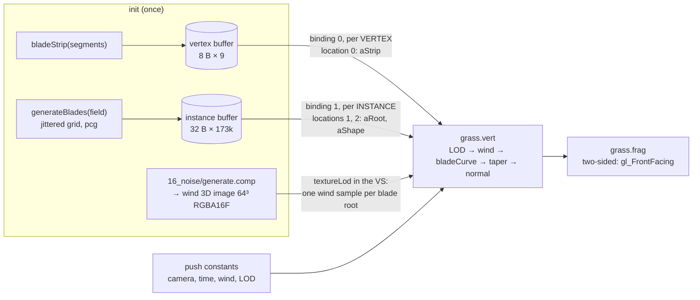
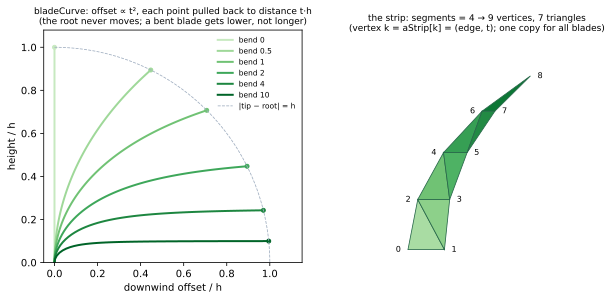
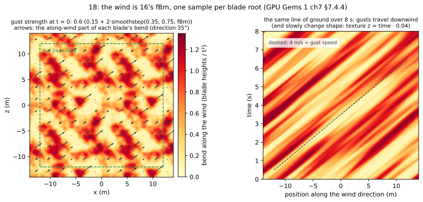

# 18_grass

## What it shows
A field of **173k grass blades** (24 m × 24 m at 300 blades/m²) drawn with **one instanced draw call**.
- A vertex buffer holds a single blade: a triangle strip of `2·segments + 1` vertices, `(edge, t)` each.
- An instance buffer holds one 32-byte record per blade: root, facing angle, height, width, lean, seed. It is
  generated on the CPU on a jittered grid (deterministic, so GL and VK get identical buffers).
- The GPU runs the strip once per record. The vertex shader bends, tapers and lights each blade from its record.

**The wind is 16's noise.** At init, 16's own `generate.comp` (its GLSL file in GL, its SPIR-V in VK) writes a 64³
tiling 3D texture. The grass vertex shader samples its fBm channel at each blade's root:
- the sample point is scrolled downwind at the gust speed, so gust fronts sweep across the field;
- time runs along the texture's z, which wraps, so gusts change shape and the animation loops seamlessly.

A per-blade sine flutter goes on top. A distance LOD thins the field out in seed order and shrinks the remaining
blades, so the field fades instead of ending at a line.

UI: the field (size, density, segments, blade size, seed: regenerates the buffers), the wind (direction, strength,
gust scale/speed, evolve, flutter), the fade distance, and three views:
- **shaded**;
- **wind gusts**: the fBm value each root sampled;
- **instance index**: which instance-buffer record drew each blade.

## Read
- [GG1 ch7 Rendering Countless Blades of Waving Grass](https://developer.nvidia.com/gpugems/gpugems/part-i-natural-effects/chapter-7-rendering-countless-blades-waving-grass)
  (Pelzer, Codecreatures). **The target chapter.** Its grass is 2003 grass: no instancing, no geometric blades.
  - §7.3 **Grass objects**: three intersecting textured quads in a star, culling off. One texture holds many
    blades in alpha, with green/yellow variation (we vary colour per blade by seed). Far objects are alpha-blended
    in and out, which needs back-to-front sorting.
  - §7.4 **Animation**: "move only the upper vertices", picked by `texcoord.v < 0.1`. Three granularities:
    - §7.4.2 per cluster: CPU wind, one draw per cluster;
    - §7.4.3 per vertex: the texture distorts;
    - §7.4.4 **per grass object**: `CalcTranslation(objectPosition, time, windDir, windStrength)`, the same offset
      for all of an object's upper vertices.

    We do §7.4.4 with the object = one blade (one wind sample per instance), and a t² weight instead of the
    binary switch.
  - The chapter never defines `CalcTranslation`. Its references (Isidoro & Card, ShaderX 2002) use sine sums, which
    is what our flutter is. The gusts are the part 16 adds.
  - Local CD: `GPU-Gems-1-CD-Content/Natural_Effects/Grass/` is only a zip of the Codecreatures demo (binary).
- [GG3 ch6 GPU-Generated Procedural Wind Animations for Trees](https://developer.nvidia.com/gpugems/gpugems3/part-i-geometry/chapter-6-gpu-generated-procedural-wind-animations-trees)
  (Zioma). Wind as a *hierarchy*: trunk, then branches, each simulated as a damped spring and composed with
  quaternions. Branches react differently depending on whether they face the wind (front/back/side). Trees are
  instanced, with per-instance state.
  - Local CD: `GPU-Gems-3-CD-Content/content/06/demo/`: `DX10Tree.fx`, `quaternion.hlsl`,
    `Src/RenderableTree*.cpp`. The `[Front]/[Back]/[Side]` branch parameters in the README are the idea worth
    taking. A grass blade is a one-level hierarchy, so we skip the springs.
- [GG3 ch16 Vegetation Procedural Animation and Shading in Crysis](https://developer.nvidia.com/gpugems/gpugems3/part-iii-rendering/chapter-16-vegetation-procedural-animation-and-shading-crysis)
  (Sousa). Main bending (whole plant, bend ∝ height², then "normalize to keep the length", which is our
  `bladeCurve`) plus detail bending (leaf-edge flutter). Shading: translucency (light through the leaf) and
  two-sided normals. Both are in `grass.frag`.
  - Local CD: `content/16` is a video only.

## Diagrams
Data flow: what each binding feeds and how often.

Per frame: one draw for the ground (4-vertex strip from `VERTEX_ID`), then one instanced draw for the grass.
- GL: `glDrawArraysInstanced(GL_TRIANGLE_STRIP, 0, 9, 173056)`.
- VK: `vkCmdDraw(cmd, 9, 173056, 0, 0)`.

Each blade's shape comes from `bladeCurve` and the strip:

The wind field the roots sample, computed with the numpy port of 16's noise:

Figures are generated by `tools/diagrams.py` (regenerate after changing the technique).

## GL path
- **The VAO describes both rates.** Binding 0 = strip (stride 8), binding 1 = blades (stride 32), then
  **`glVertexArrayBindingDivisor(vao, 1, 1)`**.
  - The divisor belongs to the *binding* (GL 4.3 vertex-attrib-binding), so both instance attributes get it.
  - Old GL set it per attribute with `glVertexAttribDivisor`.
- **Draw**: `glDrawArraysInstanced(GL_TRIANGLE_STRIP, 0, count, instances)`. The topology is an argument here.
- **Wind texture**: `gl::Program({"16_noise/shaders/generate.comp"})` is 16's file, loaded from 16's folder.
  - Dispatched once into a `GL_TEXTURE_3D`, then `glMemoryBarrier(GL_TEXTURE_FETCH_BARRIER_BIT)`.
  - That bit covers sampling from *any* stage, including the vertex shader.
- **Rebuilding the field** just replaces the buffers and the VAO. GL keeps the old buffers alive until queued
  draws are done.

## VK path
- **The rates are pipeline state.** `vertexInput.bindings = {{0, 8, VERTEX}, {1, 32, INSTANCE}}`.
  - The buffers are plain `VERTEX_BUFFER`s; an "instance buffer" isn't a kind of buffer.
  - `vkCmdBindVertexBuffers(cmd, 0, 2, ...)` binds both.
  - The topology (`TRIANGLE_STRIP`) is baked into the pipeline as well.
- **Draw**: `vkCmdDraw(cmd, 9, bladeCount, 0, 0)`. There is no separate "instanced" call: every VK draw has an
  instance count.
- **Wind texture**:
  - `vk::Image` grew a `depth` field: a 3D image + 3D view. 16 wrote that out raw; this is the helper after the
    raw version.
  - The compute pipeline is created from `16_noise/generate.comp.spv`, which exists because 16 has a `vk.cpp`.
  - It is recorded on the first frame: `UNDEFINED → GENERAL`, dispatch, then `GENERAL → SHADER_READ_ONLY` with
    `dstStage = VERTEX_SHADER | FRAGMENT_SHADER`.
- **The descriptor binding is `VERTEX | FRAGMENT`**: the grass vertex shader and the ground fragment shader both
  read it. The push-constant range is too, and both pipelines share one layout, so push constants and the set stay
  bound across `vkCmdBindPipeline`.
- **Rebuilding the field**: `vkDeviceWaitIdle`, then new buffers. VK won't keep an in-flight buffer alive for us.

## Differences that matter
- **Where "per instance" lives**: GL puts it in VAO state, set once, next to the buffers. VK puts it in the
  pipeline, next to the shaders. Any mesh drawn both instanced and not needs two pipelines in VK, but one VAO
  (or two) in GL.
- **Instance index**: `gl_InstanceID` restarts at 0 in every draw. `gl_InstanceIndex` includes `firstInstance`.
  - The `INSTANCE_ID` macro in `glint.glsl` papers over this with `gl_BaseInstance + gl_InstanceID` (GLSL 4.60).
  - Per-instance *attributes* already honour `baseInstance` in both APIs. Only the built-in differs.
  - This matters in 19, where indirect draws put one object per `firstInstance`.
- **Divisors**: GL allows any divisor. VK's binding description has only a rate; "every N instances" needs
  `VK_KHR_vertex_attribute_divisor` (core in 1.4).
- **Vertex texture fetch**: both need `textureLod` (no derivatives in a VS). VK additionally makes you say so
  twice: in the descriptor binding's `stageFlags` and in the barrier's `dstStageMask`.

## Gotchas hit
- **Parity is 45.5 dB, not ~100**. The differing pixels (652 of 480k, >2% apart) are isolated single pixels,
  denser towards the horizon.
  - Far blades are thinner than a pixel. GL and VK use different projection matrices (z in [-1,1] vs [0,1]), so
    a 1-ulp difference in a vertex flips whether a sliver covers a pixel centre.
  - That's geometric aliasing showing through, not a bug. MSAA (or a wider far blade) would fix both the parity
    number and the shimmer.
- **Avoided by design, not hit:**
  - Shrinking a blade to height 0 (the LOD) would make a finite-difference tangent zero, and `normalize` of zero is
    NaN. So the tangent is taken on the unit-height curve.
  - `ground.vert` reads `pc` too, so the push-constant range is `VERTEX | FRAGMENT` for both pipelines, and one
    layout serves both.
- The first ground plane (120 m) ended where fog was only ~76% thick: a hard grey line at the horizon. Now 400 m.
- **The laptop was in `hybrid` mode** for these measurements. VK listed only RADV and llvmpipe, and GL ran on
  radeonsi. The numbers below are the AMD iGPU's; NVIDIA numbers are still to be taken.

## Numbers
- LOC: gl.cpp 139, vk.cpp 218.
- **Parity:** 45.5 dB (see Gotchas: sub-pixel blades).
- **Validation:** clean in both APIs (0 VK validation issues incl. sync validation, 0 KHR_debug issues).
- **Default field:** 173,056 blades × 9 vertices = 1.56M vertices and 1.21M triangles in one draw. The instance
  buffer is 5.3 MB; the vertex buffer is 72 bytes.
- **GPU time** (AMD Radeon Renoir iGPU, 1600×900, Debug, 600 frames, vsync off):

  | | GL (radeonsi) | VK (RADV) |
  |---|---|---|
  | GPU mean | 4.75 ms | 4.71 ms |
  | frame mean | 6.70 ms | 6.79 ms |
  | CPU mean | 1.42 ms | 2.40 ms |

  Both APIs run the same single draw, so equal GPU time is the expected result: the API isn't in the loop.
